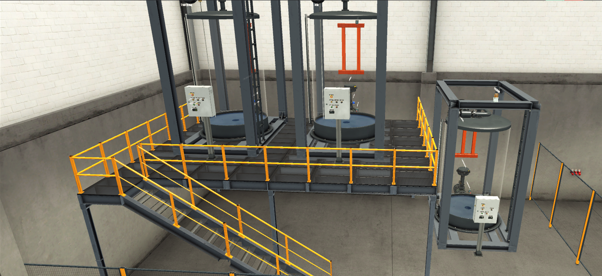

# Nivåreglering av tre tankar med PID


**PLC-styrning av tre tankar. Två tankar nivåregleras med en egen PI-regulator mot analoga börvärden och fyller på en blandningstank, där blandningsförhållandet och volymen i liter räknas fram.**



---

## I korthet

| | |
|---|---|
| **Vad** | Nivåreglering av tank 1 och 2, och en blandningstank (tank 3) som tar emot deras utflöde |
| **Plattform** | Siemens S7-1200 (CPU 1212C) i TIA Portal V21, testat i S7-PLCSIM |
| **Omfattning** | 3 funktionsblock, cykliskt avbrott 100 ms, 61 I/O-taggar |
| **Sammanhang** | Övningsprojekt under utbildningen till automationsingenjör (YH) |

**Det här visar projektet:**

- En egen PI-regulator i SCL med anti-windup, körd i ett cykliskt avbrott (OB30, 100 ms)
- Skalning av analoga signaler (0–27648 = 0–100 %) på ett ställe
- Flöde mellan tankar simulerat i PLC:n utifrån flödesmätarna, eftersom Factory IO inte kan koppla ihop tankar
- Blandningsförhållande och volym i liter för blandningstanken
- Driftsekvens med återställning, startvarning, stopp och nödstopp, plus Auto och Man per tank
- Säkerhet: fyra nödstopp och en säkerhetsdörr, spärr vid hög nivå och larm vid låg nivå

---

## Koden

Klicka på ett block för att läsa koden direkt på GitHub.

| Block | Vad det gör |
|---|---|
| [`Tankar`](blocks/Tankar.s7dcl) | Driftsekvens, skalning, säkerhet, Auto/Man, ventiler, lampor, spärr vid hög nivå, larm vid låg nivå och volym i liter |
| [`Tank_PI`](blocks/Tank_PI.s7dcl) | PI-regulator med anti-windup (instanser `PI_T1` och `PI_T2`) |
| [`Blandning`](blocks/Blandning.s7dcl) | Räknar hur många liter i tank 3 som kommer från tank 1 och 2, och ger blandningen i % |
| [`Reglering`](blocks/Reglering.s7dcl) | OB30, 100 ms: kör regulatorerna och blandningen med fast cykeltid |
| [`Main`](blocks/Main.s7dcl) | Anropar `Tankar` |

Övrigt: [taggtabell (I/O)](tags/FactoryIO.csv) · [hårdvarukonfiguration](hardware.md)

---

## Flöde

```
 Börvärde T1 (vred)          Börvärde T2 (vred)
       │                           │
   PI_T1 ─► Fill_Valve_T1      PI_T2 ─► Fill_Valve_T2
       │                           │
   ┌───▼───┐                   ┌───▼───┐
   │ Tank 1│                   │ Tank 2│
   └───┬───┘                   └───┬───┘
       │ utflöde (flödesmätare)    │
       └────────────┬──────────────┘
                    ▼  fyllning = (flöde T1 + flöde T2) × 1,4172
               ┌─────────┐
               │ Tank 3  │  blandning % och volym i liter
               └────┬────┘
                    ▼  utflöde från vredet på tank 3
```

---

## Reglering

- Nivån skalas till 0–100 % och jämförs med börvärdet från respektive vred.
- PI-regulatorn körs var 100 ms i OB30, så att integraldelen får en fast tidsbas.
- **Kp 30, Ti 40 s** fungerade utan vidare intrimning: 1–2 % översväng, och nivån höll sig inom ±0,5 % av börvärdet. En störning med större utflöde reglerades bort.
- Anti-windup stoppar integraldelen när ventilen redan står fullt öppen eller stängd.

## Blandningstanken

- Factory IO 2.5 kan inte koppla tank till tank, så tank 3:s fyllventil styrs av summan av tank 1:s och tank 2:s flödesmätare. Faktorn 1,4172 är kvoten mellan fullt utflöde (354,3 L/s) och fullt inflöde (250 L/s).
- Tank 1 och 2 tömmer bara när tank 3 är igång och inte har nått hög nivå.
- `Blandning` håller reda på hur många liter som kommit från tank 1 och tank 2, och räknar om när tank 3 töms. Resultatet visas som andel från tank 1 i %.
- Volymen i liter räknas ut från nivån (cirka 10 100 L vid 100 %, uppmätt i scenen).

---

## Driftlägen och säkerhet

| Steg | Läge | Tornljus |
|---|---|---|
| 0 | Behöver återställning, alla ventiler stängda | Gul |
| 5 | Återställer | Gul |
| 1 | Redo | Startlampa |
| 2 | Startvarning 3 s | Gul |
| 3 | Drift | Grön |
| 4 | Stoppar | Gul |
| 9 | Nödstopp eller öppen dörr, alla ventiler stängda | Röd |

- **Auto:** alla tre tankar går i drift. **Man:** varje tank startas och stoppas med sina egna knappar.
- Nödstopp, dörr och stoppknappar är brytande (TRUE = OK).
- Spärr vid hög nivå (cirka 95 %) och larm vid låg nivå (cirka 2 %).

---

## Problem som löstes

- **Tankarna kunde inte kopplas ihop i Factory IO.** Det bekräftades av Factory IO:s support. Löst genom att simulera flödet till tank 3 i PLC:n utifrån flödesmätarna.
- **Okänd tankvolym.** Factory IO anger tankens mått, men volymen mättes upp med känt flöde och flödesmätaren (cirka 10 100 L), så att literberäkningen stämmer.
- **Den inbyggda I/O:n i CPU 1212C krockade med scenens adresser.** Löst genom att flytta scenens I/O i Factory IO-drivern till egna offset (I/Q 10.x och analog 30+).

---

## Vidareutveckling

- HMI med trendkurvor för nivå, börvärde och ventilläge
- Jämföra den egna regulatorn med Siemens PID_Compact
- Recepthantering för blandningsförhållandet

---

## Verktyg

- Factory IO 2.5.10 (Siemens Edition), scen 3TankPID
- TIA Portal V21, SCL
- S7-1200 i S7-PLCSIM

---

## Om mig

Jag studerar till automationsingenjör på Teknikhögskolan Linköping (YH, 2025–2027) och har fem års erfarenhet som operatör i livsmedelsindustrin. Jag söker LIA, deltid eller anställning inom automation. Kontakta mig gärna via LinkedIn.

> Endast testat i simulering. Eventuella `Test_*`-block som skriver till ingångar ska tas bort före nedladdning till en riktig PLC.
